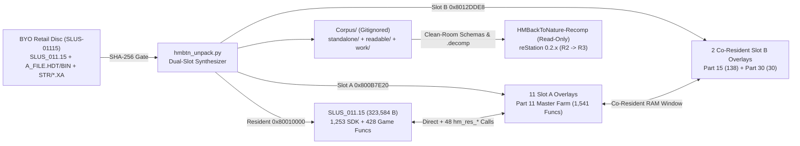
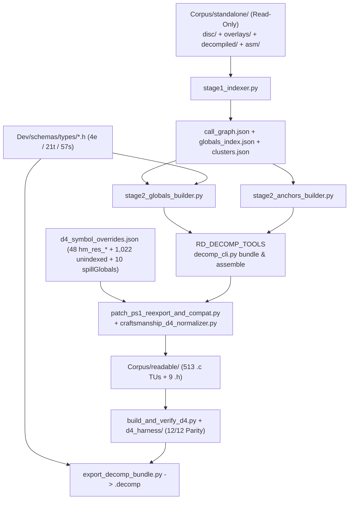

# HarvestMoonBackToNature-PlayStation — Architecture & Clean-Room System Map

**Version:** `0.2.1` (`2026-11-17`) · **Platform:** `ps1` (`SLUS-01115`) · **Pipeline:** `native_ghidra_c` · **ABI:** `ps1-mipsel` (`LP32`, `sizeof(long) == 4`)

---

## 1. System Context & Runtime Model

*Harvest Moon: Back to Nature* (`SLUS-01115`) runs on Sony PlayStation (R3000A little-endian MIPS32 + `COP2` GTE, `2 MiB` main RAM) using a resident kernel/engine executable (`SLUS_011.15`) paired with a 32-partition `A_FILE.BIN` archive and a **Dual-Slot** overlay loader (`hm_afile_load_entry_sync @ 0x800145F0`). This Tier R research container isolates copyrighted retail media inside gitignored `Corpus/` and publishes clean-room schemas, pure-stdlib decoders, and technical manuals consumed strictly **read-only** by downstream `HMBackToNature-Recomp` (`reStation` `0.2.x`).

- **Resident Memory (`SLUS_011.15`):** `323,584` B PS-X EXE (`0x800` header + `0x4E800` / `321,536` B static image loaded at `0x80010000`, `pc0 = 0x80011278`), `.text 0x80011270..0x80048B0F`, `.data 0x80048B10..0x8005E7FF`, `.bss 0x8005E800..0x800B7E1F`, and slot pointers at `0x80010098` (`Slot A`) and `0x8001009C` (`Slot B`).
- **Dual-Slot Co-Residency:** Eleven Slot A overlays load at `0x800B7E20`; Parts `15` and `30` load at **Slot B** (`0x8012DDE8`) immediately above resident **Part 11** (`.text 0x800BBC34..0x80121780`) so cross-slot calls execute simultaneously in RAM.
- **High-RAM Arena:** Dynamic OT and sprite staging buffers occupy high RAM down to `0x801F0000` (`sys_get_highram_free_bytes @ 0x8001205C`).

---

## 2. Binary, Overlay & Script Dependency Graph

| Layer / Boundary | Allowed Dependencies | Forbidden Dependencies (Hard Firewall) |
| :--- | :--- | :--- |
| **`Dev/scripts/` (Pure Stdlib)** | Python 3.12+ stdlib, `Dev/schemas/`, sibling `Dev/scripts/`, optional `--tools-dir` / `RD_DECOMP_TOOLS` / `ZIG_EXE` | External pip packages, hardcoded workstation paths, host production install roots, `Corpus/` inside `.decomp` |
| **`Dev/scripts/d4_harness/`** | `harvestmoonbtn_types.h`, `harvestmoonbtn_globals.h`, `hm_gte_cop2.h`, lifted `src/` & `overlays/` TUs | `harvestmoonbtn_functions.h` (avoids MinGW CRT `<string.h>` clashes), retail assets at compile time |
| **`Dev/schemas/` & `Dev/docs/`** | Clean-room C type headers, neutral PS1 ABI comments, repo-relative Markdown links | Retail strings (`call_graph.json` `strings: []`), `.gpr`, `*.g.cs`, `*.Generated.dll`, local file-scheme URIs |
| **`HMBackToNature-Recomp`** | Published `Dev/schemas/`, `Dev/docs/`, and validated `.decomp` packages (read-only) | Direct writes into this repo, copying `Corpus/`, or bypassing `BYO-disc` checksum gates |

---

## 3. End-to-End Data Flows

1. **BYO-Disc Verification & Unpack:** [hmbtn_unpack.py](../scripts/hmbtn_unpack.py#L82-L271) validates `requiredDiscChecksums` (hashing full `133,935,104`-byte `A_FILE.BIN` without size caps; failing closed with `MISSING_CORPUS_MEDIA` on empty input), parses `A_FILE.HDT`, scans all `22` `0x800145F0` callers, synthesizes `13` linked overlay EXEs (`Slot B` EXEs splice `SLUS_011.15 + Part 11 + Part 15/30`), and delegates `Part 9`/`0x0E`/`.TIM`/`.XA` extraction to [hmbtn_assets.py](../scripts/hmbtn_assets.py).
2. **Stage 1–3 Indexing & Typification:** [stage1_indexer.py](../scripts/stage1_indexer.py) parses `SLUS_011.15` + `13` overlay lifts, consumes retail strings strictly in memory for `classify_domain()`, clears all `call_graph.json` `"strings"` arrays to `[]`, computes `Tarjan SCC` waves (`0..24`), and indexes `3,497` globals. [stage2_globals_builder.py](../scripts/stage2_globals_builder.py) and [stage2_anchors_builder.py](../scripts/stage2_anchors_builder.py) produce disjoint `LP32`-verified `globals_map.json` and `225` typed anchors, merged with `6` shards into `functions_catalog.json` (`2,575` game functions).
3. **Stage 4 Assembly & `D4.craftsmanship` Normalization:** [patch_ps1_reexport_and_compat.py](../scripts/patch_ps1_reexport_and_compat.py) lowers `._off_sz_` subpieces, `undefined1 [2|4]` stack buffers, `(*(code *)...)` calls, and void-return promotions before `stage4_assembler` emits `513` `.c` TUs. [craftsmanship_d4_normalizer.py](../scripts/craftsmanship_d4_normalizer.py) (with [craftsmanship_d4_helpers.py](../scripts/craftsmanship_d4_helpers.py) and [d4_symbol_overrides.json](../schemas/d4_symbol_overrides.json)) then removes all Ghidra craft artifacts, promotes `sdk/` comments to Doxygen `@symbol`/`@address` headers, maps `48` `hm_res_*` calls + `10` spill globals, and renames locals/labels collision-safely.
4. **Two-Pass `D4` Build & `12/12` Parity:** [build_and_verify_d4.py](../scripts/build_and_verify_d4.py) runs **Pass 1** (`zig cc -target mipsel-freestanding-eabi -mcpu=mips2 -msoft-float` over `513` `.c` + `globals_defs.c` -> `514` ELF32 MIPS objects batched into `libharvest_moon_btn_d4.a`) and **Pass 2** (`x86-windows-gnu` with `-DHM_HOST_PARITY` over `4` lifted TUs + `d4_harness/*.c` -> `12/12` assertions PASS; `--offline-synthetic` backed by [d4_synthetic_corpus.py](../scripts/d4_synthetic_corpus.py)).
5. **Format Decoders & `.decomp` Export:** Four modular decoders (`hmbtn_overlays.py`, `hmbtn_sound.py`, `hmbtn_sprites.py`, `hmbtn_save_diary.py`) verify `68/68` spec fields, and [export_decomp_bundle.py](../scripts/export_decomp_bundle.py#L147-L221) packages `module.decomp.json`, `Dev/schemas/`, and `Dev/scripts/` into a clean-room `.decomp` archive verified by `validate_cleanroom_archive()`.

---

## 4. File & Symbol Lookup Registry

| File Path | Code SLOC / Tier | Primary Exports / Role |
| :--- | :--- | :--- |
| [Dev/scripts/hmbtn_unpack.py](../scripts/hmbtn_unpack.py) | `295` (`<= 400`) | `verify_required_disc_checksums`, `parse_hdt`, `scan_overlay_callers`, `build_linked_overlay_exe`, `unpack_all` |
| [Dev/scripts/hmbtn_assets.py](../scripts/hmbtn_assets.py) | `190` (`<= 250`) | `parse_tim_info`, `parse_and_export_tim`, `unpack_part9_sound`, `parse_sprite_pack`, `catalog_xa_streams` |
| [Dev/scripts/hmbtn_overlays.py](../scripts/hmbtn_overlays.py) | `221` (`<= 250`) | `OVERLAY_SPECS`, `parse_psx_exe_header`, `parse_hdt_bytes`, `classify_afile_partition`, `scan_overlay_call_sites` |
| [Dev/scripts/hmbtn_sound.py](../scripts/hmbtn_sound.py) | `183` (`<= 250`) | `parse_vab_header`, `parse_seq_header`, `scan_part9_sound`, `analyze_xa_stream` |
| [Dev/scripts/hmbtn_sprites.py](../scripts/hmbtn_sprites.py) | `196` (`<= 250`) | `parse_0x0e_container`, `walk_0x0e_chain`, `scan_tim_entries` |
| [Dev/scripts/hmbtn_save_diary.py](../scripts/hmbtn_save_diary.py) | `221` (`<= 250`) | `verify_save_checksums`, `unpack_save_blocks`, `decode_save_slot`, `build_synthetic_save_bytes` |
| [Dev/scripts/stage1_indexer.py](../scripts/stage1_indexer.py) | `337` (`<= 400`) | `memory_region`, `compute_waves`, `classify_domain`, `call_graph.json` / `clusters.json` builder |
| [Dev/scripts/stage2_anchors_builder.py](../scripts/stage2_anchors_builder.py) | `363` (`<= 400`) | `CURATED_ANCHORS` (`225` typed Stage 2 seed signatures across `14` images) |
| [Dev/scripts/stage2_globals_builder.py](../scripts/stage2_globals_builder.py) | `209` (`<= 250`) | `assign_program_scope`, `build_globals_map`, `validate_globals_map` (`3,497` `LP32` caller-semantic globals: `1,850` suffix-free + `1,647` disambiguated) |
| [Dev/scripts/craftsmanship_d4_helpers.py](../scripts/craftsmanship_d4_helpers.py) | `<= 250` tier | `build_compat_block`, `HmCallbackFn` + `hm_res_*` externs, `#ifdef HM_HOST_PARITY` COP2 block |
| [Dev/scripts/craftsmanship_d4_normalizer.py](../scripts/craftsmanship_d4_normalizer.py) | `<= 250` tier | `normalize_readable_tree`, Doxygen normalization, artifact scrub (`--verify-clean`, `--dry-run`) |
| [Dev/scripts/patch_ps1_reexport_and_compat.py](../scripts/patch_ps1_reexport_and_compat.py) | `<= 250` tier | Pre-assembly P-code lowering (`._off_sz_`, `undefined1 [2|4]`, void promotion) + normalizer driver |
| [Dev/scripts/d4_synthetic_corpus.py](../scripts/d4_synthetic_corpus.py) | `<= 250` tier | `_seed_synthetic_corpus`, `_generate_globals_and_stubs` (clean Doxygen + `hm_res_*` stubs) |
| [Dev/scripts/build_and_verify_d4.py](../scripts/build_and_verify_d4.py) | `<= 190` (`<= 250`) | `resolve_zig_exe`, `resolve_tools_dir`, `build_and_verify` (Pass 1 ELF32 + Pass 2 `12/12` host parity) |
| [Dev/scripts/verify_stage0_stage1.py](../scripts/verify_stage0_stage1.py) | `195` (`<= 250`) | `sha256_file`, `is_readonly`, Stage 0/1 integrity & schema parity suite (`7` checks) |
| [Dev/scripts/verify_stage2_stage3.py](../scripts/verify_stage2_stage3.py) | `<= 250` tier | Stage 2/3/4 `LP32` + `D4.craftsmanship` + `clangd` + `<= 400` line verifier (`8` checks) |
| [Dev/scripts/verify_track_d4.py](../scripts/verify_track_d4.py) | `<= 250` tier | Independent `D4` verifier (`514` ELF32 `.o`, `0` craft artifacts, `>= 12` parity, SLOC/line caps) |
| [Dev/scripts/export_decomp_bundle.py](../scripts/export_decomp_bundle.py) | `208` (`<= 250`) | `build_module_decomp_manifest`, `validate_cleanroom_archive`, `export_decomp_bundle` |
| [Dev/scripts/tests/test_hmbtn_parsers.py](../scripts/tests/test_hmbtn_parsers.py) | `133` (test) | Isolated parser unit & `--offline-synthetic` / fail-closed CLI tests |
| [Dev/scripts/tests/test_hmbtn_decomp_cleanroom.py](../scripts/tests/test_hmbtn_decomp_cleanroom.py) | `<= 250` (test) | `validate_cleanroom_tree`, `spec_coverage`, normalizer cleanliness, SLOC & `.decomp` export tests |
| `Dev/scripts/d4_harness/*.{c,h}` (`6` files) | `<= 250` / TU | `hm_gte_cop2.h`, `parity_harness.h`, `parity_media_cd_tests.c`, `parity_core_sys_tests.c`, `parity_sim_and_gte_tests.c`, `parity_stubs_and_main.c` |

- **`Corpus/readable/` Layout (`526` Non-Cache Files):** `513` `.c` TUs (`129` `sdk/*.c` [`1,253` funcs] + `52` `src/<domain>/*.c` [`428` funcs across `7` resident dirs] + `332` `overlays/<OVL>/*.c` [`2,147` funcs across `13` overlay dirs]), `9` `.h` headers (`include/` + `include/types/`), `2` `.md` navigation indices (`SYMBOL_MAP.md`, `ARCHITECTURE_WALKTHROUGH.md`), `compile_commands.json`, and `.clangd`.

---

## 5. Schema & Data Ownership Map

| Schema / Header Artifact | Producer / Owner | Consumers | Canonical Standard 18 / Key Contract |
| :--- | :--- | :--- | :--- |
| [Dev/research.manifest.json](../research.manifest.json) | Stage gates + `build_and_verify_d4.py` | `decomp_cli.py`, `verify_track_d4.py` | `schemaVersion: 2`, `currentDecompTier: "D4"`, `currentStudyTier: "S4"`, `recompProjectPath` |
| [standalone_integrity.json](../schemas/standalone_integrity.json) | `Stage 0` baseline freeze | `hmbtn_unpack.py`, `verify_stage0_stage1.py` | `requiredDiscChecksums` (`A_FILE.BIN` `133,935,104` B SHA-256), `generatedAtUtc` |
| [call_graph.json](../schemas/call_graph.json), [globals_index.json](../schemas/globals_index.json), [clusters.json](../schemas/clusters.json) | `stage1_indexer.py` | `stage2_*`, `verify_stage0_stage1.py` | `3,828` nodes (`strings: []`), `3,497` globals, `23` domains, `waves 0..24` |
| [globals_map.json](../schemas/globals_map.json), [anchor_functions.json](../schemas/anchor_functions.json), [functions_catalog.json](../schemas/functions_catalog.json), `shards/*.json` | `stage2_*_builder.py` + `decomp_cli bundle` | `GhidraUniversalApplyAndExport.java`, `verify_stage2_stage3.py` | `3,497` `LP32` globals (`2,986` standalone + `511` `struct_member`), `225` anchors + `2,350` shards = `2,575` game funcs |
| [d4_symbol_overrides.json](../schemas/d4_symbol_overrides.json) | `craftsmanship_d4_normalizer.py` | `craftsmanship_d4_helpers.py`, `stage2_globals_builder.py`, `verify_stage2_stage3.py` | Declarative `semanticConfig` (`5` tables), `unindexedGlobals` (`1,022`: `706` suffix-free + `316` disambiguated; `0` `g_dat_*`/`g_unk_*`), `residentFunctions` (`48` `hm_res_*`), + `spillGlobals` (`10`) |
| [harvestmoonbtn_types.h](../schemas/harvestmoonbtn_types.h) + `Dev/schemas/types/*.h` (`5` headers + `header_order.json`) | Manual curation (`Stage 2`) | `stage2_*`, `export_decomp_bundle.py`, `d4_harness/` | `4` enums, `21` typedefs, `57` structs (`31` PS1 SDK + `26` game structs), neutral ABI notes |
| [d4_build_report.json](../schemas/d4_build_report.json), [s4_verify_report.json](../schemas/s4_verify_report.json), [spec_coverage.json](../schemas/spec_coverage.json), [decomp_recipe.json](../schemas/decomp_recipe.json) | `build_and_verify_d4.py`, parsers, recipe | `verify_track_d4.py`, `export_decomp_bundle.py`, `test_hmbtn_decomp_cleanroom.py` | Standard 18 keys (`generatedAtUtc`, `isPassed`, `unresolvedFieldCount`, `compiledFileCount`, `assertionsPassedCount`, `assertionsTotalCount`) |

---

## 6. Failure Modes & Resilience

| Failure Mode | Detection Point | Recovery / Fail-Closed Path |
| :--- | :--- | :--- |
| **`MISSING_CORPUS_MEDIA`** | Empty or missing `--data-dir` in `hmbtn_unpack.py`, `hmbtn_*.py`, `craftsmanship_d4_normalizer.py`, `build_and_verify_d4.py` | Emits structured `{"status": "MISSING_CORPUS_MEDIA", ...}` JSON and exits non-zero without creating dummy output |
| **`> 64 MiB` SHA-256 Mismatch** | `verify_required_disc_checksums` (`hmbtn_unpack.py`) / `sha256_file` (`verify_stage0_stage1.py`) | Reads `133,935,104`-byte `A_FILE.BIN` in `1 MiB` chunks; exits non-zero with `CHECKSUM_MISMATCH` and actual vs. expected digest |
| **Slot B Co-Residency Collision** | `build_linked_overlay_exe` / `GhidraUniversalApplyAndExport.java` (`win[0] >= 0x80120000`) | Linked Slot B EXEs splice `SLUS_011.15 + Part 11 + Part 15/30`, and symbol application resolves `Part 11` symbols `< win[0]` |
| **COP2 Divider / Depth Overflow (`FLAG`)** | `gte_rtps` / `gte_stflg` in `hm_gte_project_svector_to_ot` & `hm_gte_cop2.h` | Sets `FLAG` bit `31` (`0x80000000`) when `Z <= H/2` or perspective clamps; game branches on `flag < 0` to drop off-screen / zero-Z vertices |
| **Windows `zig ar` Arg Overflow (`WinError 206`)** | `build_and_verify_d4.py` archiving `514` `.o` objects | Chunks archive creation into `80`-object relative-path batches with `cwd=obj_root` followed by `zig ar s` |
| **Host CRT `<string.h>` Prototype Clash** | Pass 2 `x86-windows-gnu` linking in `build_and_verify_d4.py` | Excludes `harvestmoonbtn_functions.h` from `d4_harness/` and filters `LIBC_SYMS` out of generated `host_stubs.c` |

---

## 7. Security & Clean-Room Model

- **Three-Layer Containment:** `Corpus/`, `Archive/`, `Dev/data/`, `Dev/logs/`, `*.decomp`, and `Dev/docs/{plans,reports}/` are excluded via `.gitignore` and `-xr!Corpus\*` in `.7z` archives; `Corpus/standalone/` enforces OS `IsReadOnly = true`.
- **Zero Retail Media / Secrets (`SECURITY.md`):** No retail binaries, `.tim`/`.vab`/`.seq`/`.xa` assets, BIOS files, `.gpr` databases, `*.g.cs`, `*.Generated.dll`, vendor SDK brand prose, workstation paths, local file-scheme URIs, or secrets appear in Git or `.decomp` exports; live Notion IDs stay in gitignored `Dev/data/notion_hub.local.json` and webhooks read `DISCORD_WEBHOOK_FOUNDATION` from environment only.
- **Scrubbed Metadata & Pure Stdlib:** `stage1_indexer.py` clears `call_graph.json` `"strings"` arrays to `[]` after in-memory classification; all Python tools execute without `shell=True`, `eval`, or external pip packages; `export_decomp_bundle.py --verify-cleanroom` validates every archive entry byte-for-byte.

---

## 8. Testing & Verification Strategy Map

| Suite / Command | Scope Covered | Runtime Mode | Known Boundary / Notes |
| :--- | :--- | :--- | :--- |
| `python -B -m unittest discover -s Dev/scripts/tests -v` | `4` parsers, `.mcr` extraction, `3`-tier XOR, `spec_coverage`, normalizer cleanliness, SLOC, `.decomp` | Isolated `%TEMP%` | Zero retail media or `Corpus/` writes required |
| `python -B Dev/scripts/verify_stage0_stage1.py` | `standalone_integrity` schema, 3-folder layout, RO baseline, SHA-256, `3,828` Stage 1 parity, `<= 400` lines | `--offline-synthetic` or live `Corpus/` | Live mode requires BYO media in `Corpus/standalone/` |
| `python -B Dev/scripts/verify_stage2_stage3.py` | `4e/21t/57s`, `3,497` globals, `2,575` catalog, `0` `D4.craftsmanship` hits, `clangd`, `<= 400` lines | `--offline-synthetic` or live `Corpus/` | Pass `--no-clangd` where LLVM `clangd` is absent |
| `python -B Dev/scripts/build_and_verify_d4.py` | Pass 1 `513/513` MIPS ELF32 `.o`/`.a` (`0` err/warn) + Pass 2 `12/12` Q12 GTE / farm / save-XOR parity | `--offline-synthetic` (`--data-dir`) or live | Requires `zig` (`ZIG_EXE`, `PATH`, or `%LOCALAPPDATA%`) |
| `python -B Dev/scripts/verify_track_d4.py` | Report Standard 18 schema, `514` ELF32 MIPS checks, `D4.craftsmanship`, `>= 12` parity, SLOC/line caps | `--offline-synthetic` or live `Corpus/` | Enforces `<= 250` SLOC on `d4_harness/*.{c,h}` |
| `python -B Dev/scripts/export_decomp_bundle.py --verify-cleanroom` | Emits `.decomp` ZIP + runs `PsxCleanRoomValidator` byte/path/magic/token checks | Pure stdlib | Output directed to `--out` or `--data-dir` |
| `python -B "$env:RD_DECOMP_TOOLS\decomp_cli.py" verify --track HarvestMoonBackToNature-PlayStation` | Upstream universal `R&D` `D4`, `S4`, and default `R1`/`R2` path checks | Research track CLI | Requires sibling `R&D` or `RD_DECOMP_TOOLS` env |

---

## 9. Design Decisions Log (ADRs)

- **ADR-001 · 2026-11-13 · `v0.1.0` — Dual-Slot Linked Overlay Synthesis:** *Context:* Slot B overlays (`0x8012DDE8`) call into co-resident `Part 11` (`0x800B7E20`) and `SLUS_011.15` (`0x80010000`). *Decision:* Splice `SLUS_011.15 + Part 11 + Slot B` in `build_linked_overlay_exe` and patch `GhidraUniversalApplyAndExport.java` for `win[0] >= 0x80120000`. *Consequences:* Cross-slot calls decompile and compile without manual jump thunks.
- **ADR-002 · 2026-11-16 · `v0.2.0` — `call_graph.json` Retail String Exclusion:** *Context:* Serialized `strings` arrays risked leaking retail text in tracked JSON. *Decision:* Consume strings in memory inside `classify_domain()` and emit `"strings": []` across all `3,828` nodes. *Consequences:* Zero downstream impact; public-repo clean-room compliance.
- **ADR-003 · 2026-11-17 · `v0.2.1` — Declarative `D4.craftsmanship` & Caller-Semantic Globals:** *Context:* Ghidra lifts left `81,097 + 8,339 + 4,389` raw artifacts, `48` uncataloged `FUN_800*` calls, and generic/address-suffixed globals (`g_dat_*`/`g_unk_*`). *Decision:* Externalize `semanticConfig` (`5` tables), `1,022` `unindexedGlobals` (`706` suffix-free + `316` disambiguated), `48` `hm_res_*`, and `10` spill mappings into `d4_symbol_overrides.json`, upgrade `stage2_globals_builder.py` for caller-derived suffix-free naming (`1,850` suffix-free + `1,647` disambiguated across `3,497` indexed globals), and run `craftsmanship_d4_normalizer.py` post-assembly. *Consequences:* Zero craft artifacts, `2,556` suffix-free globals (`0` `g_dat_*`/`g_unk_*`), and clean Doxygen headers across `513/513` `.c` files without mutating upstream `R&D` tools.
- **ADR-004 · 2026-11-17 · `v0.2.1` — Deterministic Q12 GTE (`COP2`) Host Parity:** *Context:* GTE macros previously expanded to no-ops on host x86. *Decision:* Implement integer `Q12` (`4096 = 1.0`) `COP2` state (`RTPS`/`MVMVA`/`NCLIP`/`AVSZ3`/`FLAG`) in `d4_harness/hm_gte_cop2.h` gated by `-DHM_HOST_PARITY`. *Consequences:* Pass 2 verifies real lifted `render_gte_sprites_07.c` and `ovl_part11_id06_06.c` (`12/12` assertions).
- **ADR-005 · 2026-11-16 · `v0.2.0` — Clean-Room `.decomp` Recipe Packaging:** *Context:* Downstream `reStation` requires self-contained metadata without copyrighted files. *Decision:* Package `module.decomp.json`, `Dev/schemas/`, and `Dev/scripts/` via `export_decomp_bundle.py` with `PsxCleanRoomValidator`. *Consequences:* `reStation 0.2.x` consumes reproducible clean-room recipes (`R2 -> R3`).

---

## 10. Zero-Touch Extension Playbooks

1. **Add a Specification Spoke & Modular Decoder:** Author `Dev/docs/specifications/<topic>.md` (`150–380` lines), implement a pure-stdlib `<= 250`-SLOC parser `Dev/scripts/hmbtn_<topic>.py` supporting `--data-dir`, `--log-dir`, `--offline-synthetic`, and `MISSING_CORPUS_MEDIA`, add isolated `unittest` coverage in `Dev/scripts/tests/`, and register the spoke + field count in [spec_coverage.json](../schemas/spec_coverage.json) and [SPECIFICATIONS.md](SPECIFICATIONS.md).
2. **Add a Pass-2 LP32 Host Parity TU:** Create `Dev/scripts/d4_harness/<suite>.c` (`<= 250` code-only SLOC) exporting `int d4_run_<suite>(D4ParityResult *out, int max_out);`, declare and invoke it from [parity_harness.h](../scripts/d4_harness/parity_harness.h) and [parity_stubs_and_main.c](../scripts/d4_harness/parity_stubs_and_main.c) (Pass-2 globbing compiles all `d4_harness/*.c` automatically), and add synthetic stubs in [d4_synthetic_corpus.py](../scripts/d4_synthetic_corpus.py) if linking new lifted functions.
3. **Add Symbol Overrides Without Editing Normalizer Logic:** Append entries under `residentFunctions`, `unindexedGlobals`, or `spillGlobals` in [d4_symbol_overrides.json](../schemas/d4_symbol_overrides.json), then re-run `patch_ps1_reexport_and_compat.py` (or `craftsmanship_d4_normalizer.py --verify-clean`) so `ghidra_compat.h`, `harvestmoonbtn_globals.h`, and all `513` `.c` files update deterministically.
