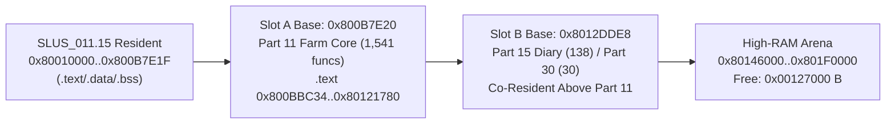

# Dual-Slot Overlay Co-Residency & `A_FILE` Streaming (`SLUS-01115`)

**Findings ID:** `dual-slot-overlay-and-afile-streaming` · **Parent Hub:** [Dev/docs/FINDINGS.md](../FINDINGS.md) · **Related Spec:** [afile-and-overlays.md](../specifications/afile-and-overlays.md) · **Unpacker:** [hmbtn_unpack.py](../../scripts/hmbtn_unpack.py)

This empirical report documents the Sony PlayStation (`SLUS-01115`) resident executable geometry, the `A_FILE.HDT` / `A_FILE.BIN` partition loader, all `22` verified call sites of `hm_afile_load_entry_sync` (`0x800145F0`), **Slot A / Slot B** simultaneous RAM co-residency, and all `48` uncataloged `hm_res_*` resident helper exports invoked by overlays.

---

## 1. Resident Executable & Main RAM Geometry (`SLUS_011.15`)

`SLUS_011.15` (`323,584` B = `0x800`-byte PS-X EXE header + `0x4E800` / `321,536` B static image) boots directly into R3000A RAM at `0x80010000` with `pc0 = 0x80011278` (`hm_crt0_start`), not older placeholder guesses such as `0x80012224`. At startup, `hm_crt0_start` (`0x80011278`) zeroes `.bss` up to `0x800B7E20`, calls `InitHeap(..., 0x1401E0)`, and enters `hm_main` (`0x80011370`).

| Region / Anchor | Virtual Address Range | Byte Span | Verified Contents & Empirical Notes |
| :--- | :--- | ---: | :--- |
| **PS-X Header (`0x800` B)** | File `+0x00..+0x7FF` | `2,048` | `pc0 = 0x80011278`, `gp0 = 0`, `t_addr = 0x80010000`, `t_size = 0x4E800`, `sp_base = 0x801FFF00` |
| **Slot Pointer Pair (`+0x98`)** | `0x80010098..0x8001009F` | `8` | Resident `uint32[2]` storing **Slot A** (`0x800B7E20`) and **Slot B** (`0x8012DDE8`) |
| **Resident `.text`** | `0x80011270..0x80048B0F` | `227,488` | `1,681` functions (`1,253` SDK + `428` game functions across `7` resident domains) |
| **Resident `.data`** | `0x80048B10..0x8005E7FF` | `89,328` | `631` initialized globals (`g_cd_afile_toc_head`, `g_audio_spu_tick_vab_async_prepare_table`, `g_cd_xa_channel_table`) |
| **Resident `.bss`** | `0x8005E800..0x800B7E1F` | `366,112` | `1,219` runtime globals (`HmEngineState`, `HmCalendarClock`, `HmPlayerState`, crop/animal tables) |
| **Slot A Overlay Window** | `0x800B7E20..0x8012DDE7` | `483,272` | Holds `11` Slot A overlays; **Part 11** `.text` spans `0x800BBC34..0x80121780` (`483,328` B) |
| **Slot B Co-Resident Window** | `0x8012DDE8..0x80145FFF` | `98,840` | Holds **Part 15** (`98,304` B) or **Part 30** (`28,672` B) directly above live **Part 11** |
| **High-RAM Arena** | `0x80146000..0x801F0000` | `~696,320` | Double-buffered `0x800`-entry OTs + `96,000`-B prim arenas (`0x801F0000 - 0x800C9000 = 0x00127000` free) |

- **High-RAM Accounting (`sys_get_highram_free_bytes @ 0x8001205C`):** Computes `(s32)(g_core_engine_state.prim_arena - 0x49000 - g_sys_highram_reserved_base)`, matching exact LP32 R3000A arithmetic verified in [parity_core_sys_tests.c](../../scripts/d4_harness/parity_core_sys_tests.c).

---

## 2. `A_FILE.HDT` Byte-Offset Table & CD Streaming Pipeline

During boot, `hm_cd_poll_async_queue` (`0x800147BC`) reads `\A_FILE.HDT;1` via `hm_cd_read_named_file` (`0x80014554`), copies `33` `uint32` offsets into `g_cd_afile_toc_head` (`HmAfileTocEntry[33]`, `0x28` B stride), and locates `\A_FILE.BIN;1` via `CdSearchFile` to latch `g_cd_afile_request.base_lba`.

- **Byte-Offset Invariant:** Every entry in the `132`-byte `A_FILE.HDT` (`uint32[33]`) stores an exact **byte offset** aligned to `0x800`-byte (`2,048` B) CD-ROM sectors, starting at `0x00000000` and ending at `133,935,104` B (`65,398` sectors):
  - `sector_lba_rel = toc[entry_idx].offset_bytes >> 11`
  - `sector_count = ((toc[sub_idx].offset_bytes >> 11) - sector_lba_rel) + ((toc[sub_idx].offset_bytes & 0x7FF) != 0)`
  - `aligned_bytes = ((toc[load_toc + 1].offset_bytes - toc[load_toc].offset_bytes) + 3) & ~3` (`hm_cd_init_afile_system @ 0x80014748`)
- **Partition Breakdown (`32` Partitions, `0..31`):**
  - `Parts 0..1, 7`: `0x100D` VRAM rect streams (`64,475,136` B; `1,683,456` B; `63,488` B).
  - `Parts 2..5`: `0xFFFFFFFF` 3D stage geometry & tile clusters (`15.16M`, `16.88M`, `5.33M`, `11.41M` B).
  - `Parts 6, 12, 13, 29`: HUD sub-archive (`458,752` B), dialogue/world blob (`10,878,976` B), layout/font (`69,632` B), and Part 11 event blob (`75,776` B).
  - `Part 9`: `6,006,784` B audio archive (`39` `pBAV` VABp soundbanks + `36` `pQES` SEQ tracks).
  - `Parts 14, 18, 20, 22, 24, 26`: Chained `0x0E` sprite animation containers (`52` banks total + `0x100D` VRAM trailers).
  - `Part 16`: `4,096` B texture bundle (`12` `4bpp` CLUT `.TIM` images).
  - `Parts 8, 10, 11, 15, 17, 19, 21, 23, 25, 27, 28, 30, 31`: `13` executable MIPS overlay payloads (`ovl_id` word at `+0x00`).
- **Async Ring (`hm_cd_enqueue_async_read @ 0x80014988`):** Issues `CdReadBreak()` -> `cd_sdk_flush()` -> `cd_sdk_sync()`, populates `HmAfileRequest` (`0x44` B at `0x8005E3F0`), seeks via `CdControl(0x02)` / `0x0E` double-speed mode, and sets `async_state = 1` for background VAB/stage DMA streaming.

---

## 3. Complete Inventory of All `22` `hm_afile_load_entry_sync` (`0x800145F0`) Call Sites

Static MIPS `jal 0x800145F0` scanning ([hmbtn_unpack.py](../../scripts/hmbtn_unpack.py#L124-L160)) and [hmbtn_overlays.py](../../scripts/hmbtn_overlays.py#L120-L139) recover **exact `22` synchronous load calls** (`21` inside `hm_main`'s `HmOverlayId` switch `0x00..0x14` + `1` inside `OVL_part11_id06.EXE`):

| # | Source Image | Call VA | `part_start..end` | Slot Arg (`a2`/`a3`) | Dispatched Entry / Target Role |
| ---: | :--- | :--- | :--- | :--- | :--- |
| `1` | `SLUS_011.15` | `0x800116E8` | `8..9` | `0x800B7E20` (Slot A) | `0x800B8014` (`OVL_part08_id04`: Kanji font test stub) |
| `2` | `SLUS_011.15` | `0x80011714` | `10..11` | `0x800B7E20` (Slot A) | `0x800B889C` (`OVL_part10_id05`: PDA / PocketStation menu) |
| `3` | `SLUS_011.15` | `0x8001175C` | `11..12` | `0x800B7E20` (Slot A) | `0x800BBC34` (`OVL_part11_id06`: core farm mode `0x02`) |
| `4` | `SLUS_011.15` | `0x800117A0` | `17..18` | `0x800B7E20` (Slot A) | `0x800B7E38` (`OVL_part17_id07`: Swimming Festival mode `0x03`) |
| `5` | `SLUS_011.15` | `0x800117CC` | `19..20` | `0x800B7E20` (Slot A) | `0x800B7ED8` (`OVL_part19_id08`: Chicken Sumo mode `0x04`) |
| `6` | `SLUS_011.15` | `0x800117F8` | `21..22` | `0x800B7E20` (Slot A) | `0x800B7E3C` (`OVL_part21_id09`: Horse Race mode `0x05`) |
| `7` | `SLUS_011.15` | `0x80011834` | `11..12` | `0x800B7E20` (Slot A) | Mode `0x06` alternate `Part 11` reload |
| `8` | `SLUS_011.15` | `0x80011884` | `15..16` | `0x8012DDE8` (Slot B) | `0x8012E2CC` (`OVL_part15_id10`: Diary Save over live Part 11) |
| `9` | `SLUS_011.15` | `0x800118CC` | `15..16` | `0x8012DDE8` (Slot B) | `0x8012E520` (`OVL_part15_id10`: New-Game setup over Part 11) |
| `10` | `SLUS_011.15` | `0x80011914` | `15..16` | `0x8012DDE8` (Slot B) | `0x8012E7C8` (`OVL_part15_id10`: Diary slot render over Part 11) |
| `11` | `SLUS_011.15` | `0x80011950` | `23..24` | `0x800B7E20` (Slot A) | `0x800B7EA4` (`OVL_part23_id0a`: Dog Race mode `0x0B`) |
| `12` | `SLUS_011.15` | `0x8001197C` | `25..26` | `0x800B7E20` (Slot A) | `0x800B7EB4` (`OVL_part25_id0b`: Tomato Festival mode `0x0C`) |
| `13` | `SLUS_011.15` | `0x800119B4` | `27..28` | `0x800B7E20` (Slot A) | `0x800B7EEC` (`OVL_part27_id0c`: Opening intro / title mode `0x0D`) |
| `14` | `SLUS_011.15` | `0x80011A00` | `11..12` | `0x800B7E20` (Slot A) | Mode `0x0E` town scripted event `Part 11` reload |
| `15` | `SLUS_011.15` | `0x80011A44` | `11..12` | `0x8012DDE8` (Slot B ptr) | Mode `0x0F` festival director `Part 11` load (passes Slot B addr) |
| `16` | `SLUS_011.15` | `0x80011A78` | `28..29` | `0x800B7E20` (Slot A) | `0x800B7E24` (`OVL_part28_id0d`: Credits & ending slideshow) |
| `17` | `SLUS_011.15` | `0x80011AB4` | `11..12` | `0x800B7E20` (Slot A) | Mode `0x13` post-credits `Part 11` reload |
| `18` | `SLUS_011.15` | `0x80011AF0` | `30..31` | `0x8012DDE8` (Slot B) | `0x8012F084` (`OVL_part30_id0f`: Developer inspection menu) |
| `19` | `SLUS_011.15` | `0x80011B24` | `31..32` | `0x800B7E20` (Slot A) | `0x800B7FCC` (`OVL_part31_id0e`: Memory Card backup utility) |
| `20` | `SLUS_011.15` | `0x80011B74` | `11..12` | `0x800B7E20` (Slot A) | Mode `0x14` epilogue `Part 11` reload |
| `21` | `SLUS_011.15` | `0x80011BE4` | `11..12` | `0x800B7E20` (Slot A) | `0x800BBC34` (`Part 11` fallback/restart dispatch) |
| `22` | `OVL_part11_id06` | `0x800E3CB8` | `29..30` | RAM scratch (`0`) | Loads `Part 29` (`75,776` B) event / snapshot data (`0x800E3C4C`) |

> [!NOTE]
> Call site `#15` (`0x80011A44`, `HM_OVL_FESTIVAL_MAIN`) is an empirical quirk in `hm_main`: it invokes `hm_afile_load_entry_sync(0xB, 0xC, ...)` passing `&g_cd_main_copy_word` when loading `Part 11` (`483,328` B), whereas call sites `#18` (`0x80011AF0`) and `#8..#10` load `Part 30` and `Part 15` into `0x8012DDE8` **after** `Part 11` is already resident at `0x800B7E20`.

---

## 4. Dual-Slot Co-Residency Mechanics (`Part 11` + `Parts 15 / 30`)

Because Sony PS1 overlays lack dynamic ELF relocation tables, the retail linker fixed **Slot A** (`0x800B7E20..0x8012DDE7`) and **Slot B** (`0x8012DDE8..0x80145FFF`) at non-overlapping RAM bases:

1. **Synthesized Linked PS-X Executables (`build_linked_overlay_exe`):** [hmbtn_unpack.py](../../scripts/hmbtn_unpack.py#L199-L212) reconstructs standalone Ghidra analysis targets by placing `SLUS_011.15` at `0x80010000`, splicing `Part 11` (`0x800B7E20..0x8012DDE7`) whenever `ovl_base == 0x8012DDE8`, and writing the Slot B payload at `0x8012DDE8`.
2. **Dual-Range Executable Disassembly:** Slot B manifests declare three executable `.text` windows (`0x80011270..0x80048B10` resident + `0x800BBC34..0x80121780` Part 11 + Slot B `.text`).
3. **Cross-Slot Symbol Binding (`win[0] >= 0x80120000`):** `GhidraUniversalApplyAndExport.java` passes the resolved export window `win` to `applyGlobals(...)` and `applyAnchors(...)`, binding `Part 11` symbols below `win[0]` inside Slot B (`Part 15`: `2,094` anchors / `2,803` globals; `Part 30`: `1,987` anchors / `2,806` globals).
4. **Tarjan Wave Visibility (`stage1_indexer.py`):** [compute_waves](../../scripts/stage1_indexer.py#L99-L127) explicitly treats `OVL_part11_id06.EXE` as visible from `SLOT_B_PROGS` (`OVL_part15_id10.EXE`, `OVL_part30_id0f.EXE`), wiring `SLUS` <-> `Part 11` <-> `Slot B` edges cleanly across `2,029` cross-image edges.

| Overlay Image | Part | ID | Slot | Base | Size (B) | Funcs | `.c` Files |
| :--- | ---: | :--- | :--- | :--- | ---: | ---: | ---: |
| `OVL_part08_id04.EXE` | `8` | `0x04` | `A` | `0x800B7E20` | `2,048` | `5` | `1` |
| `OVL_part10_id05.EXE` | `10` | `0x05` | `A` | `0x800B7E20` | `16,384` | `23` | `7` |
| `OVL_part11_id06.EXE` | `11` | `0x06` | `A` | `0x800B7E20` | `483,328` | `1,541` | `225` |
| `OVL_part15_id10.EXE` | `15` | `0x10` | `B` | `0x8012DDE8` | `98,304` | `138` | `26` |
| `OVL_part17_id07.EXE` | `17` | `0x07` | `A` | `0x800B7E20` | `26,624` | `61` | `9` |
| `OVL_part19_id08.EXE` | `19` | `0x08` | `A` | `0x800B7E20` | `32,768` | `76` | `11` |
| `OVL_part21_id09.EXE` | `21` | `0x09` | `A` | `0x800B7E20` | `36,864` | `67` | `10` |
| `OVL_part23_id0a.EXE` | `23` | `0x0A` | `A` | `0x800B7E20` | `34,816` | `55` | `8` |
| `OVL_part25_id0b.EXE` | `25` | `0x0B` | `A` | `0x800B7E20` | `34,816` | `65` | `10` |
| `OVL_part27_id0c.EXE` | `27` | `0x0C` | `A` | `0x800B7E20` | `57,344` | `53` | `8` |
| `OVL_part28_id0d.EXE` | `28` | `0x0D` | `A` | `0x800B7E20` | `12,288` | `27` | `4` |
| `OVL_part30_id0f.EXE` | `30` | `0x0F` | `B` | `0x8012DDE8` | `28,672` | `30` | `12` |
| `OVL_part31_id0e.EXE` | `31` | `0x0E` | `A` | `0x800B7E20` | `4,096` | `6` | `1` |

---

## 5. Complete Registry of All `48` `hm_res_*` Resident Helper Exports (`491` Call Sites)

Static auditing of `Corpus/readable/overlays/**/*.c` uncovered `48` internal `SLUS_011.15` resident helpers invoked across `491` overlay call sites that lay inside sub-entries or outside Stage 3 shards. [d4_symbol_overrides.json](../../schemas/d4_symbol_overrides.json) maps all `48` to deterministic suffix-free `hm_res_<domain>_<desc>` exports declared in `ghidra_compat.h`:

| Address | Mapped `hm_res_*` Symbol | Sites | Domain / Verified Overlay Usage |
| :--- | :--- | ---: | :--- |
| `0x80011EF0` | `hm_res_sys_wait_vblank` | `32` | System: wait VBlank barrier |
| `0x80011F08` | `hm_res_sys_poll_frame` | `5` | System: poll frame sync tick |
| `0x800121D4` | `hm_res_sys_reset_state` | `2` | System: reset core display/loop state |
| `0x8001316C` | `hm_res_gfx_lerp_rgb_fade` | `6` | Graphics: ambient RGB fade interpolation |
| `0x800132F0` | `hm_res_cd_wait_load_sync` | `34` | CD-ROM: blocking transfer sync |
| `0x80013400` | `hm_res_cd_poll_stream` | `1` | CD-ROM: stream poll check |
| `0x80013AEC` | `hm_res_pad_reset_port` | `2` | Input: reset controller port state |
| `0x80015814` | `hm_res_spr_anim_step_a` | `17` | Sprites `0x0E`: advance slot anim A |
| `0x80015828` | `hm_res_spr_anim_step_b` | `17` | Sprites `0x0E`: advance slot anim B |
| `0x8001585C` | `hm_res_spr_bind_ctx` | `29` | Sprites `0x0E`: bind actor context |
| `0x80015868` | `hm_res_spr_set_header` | `21` | Sprites `0x0E`: set `HmLzSpriteHeader` |
| `0x80015894` | `hm_res_spr_bind_anim_tbl` | `3` | Sprites `0x0E`: bind animation table |
| `0x8001589C` | `hm_res_spr_lookup_frame` | `6` | Sprites `0x0E`: query keyframe status |
| `0x800158D8` | `hm_res_spr_reset_slot` | `4` | Sprites `0x0E`: clear sprite descriptor |
| `0x80015A18` | `hm_res_spr_submit_ot_fx` | `2` | Sprites `0x0E`: submit OT effect sprite |
| `0x80017A08` | `hm_res_ui_bind_font_slot` | `24` | UI: bind font glyph slot |
| `0x80017F30` | `hm_res_ui_format_actor_text` | `2` | UI: format actor/farm string token |
| `0x800183B8` | `hm_res_ui_set_kanji_origin` | `1` | UI: set Kanji render origin |
| `0x8001AAB8` | `hm_res_ui_alloc_text_slot` | `2` | UI: allocate text window buffer |
| `0x8001ABF0` | `hm_res_ui_draw_icon_row` | `7` | UI: draw HUD icon strip |
| `0x8001AF34` | `hm_res_evt_clear_flags` | `1` | Events: zero `0x8006C870` flag table |
| `0x8001BB88` | `hm_res_gte_reset_regs` | `1` | GTE: reset COP2 matrix/color regs |
| `0x8001BBD8` | `hm_res_gte_push_matrix` | `1` | GTE: push active matrix stack |
| `0x8001BFA8` | `hm_res_gfx_init_mesh_ctx` | `9` | Graphics: init 3D mesh render context |
| `0x8001E334` | `hm_res_gfx_reset_world_spr` | `8` | Graphics: reset world sprite queue |
| `0x8001E340` | `hm_res_gfx_flush_mesh_ctx` | `5` | Graphics: flush 3D mesh context |
| `0x8001EF8C` | `hm_res_map_clear_tile_ptr` | `2` | Map: clear collision tile pointer |
| `0x8001EF98` | `hm_res_map_get_tile_attr` | `8` | Map: read tile height/surface attribute |
| `0x8001F2EC` | `hm_res_npc_emit_actor_quad` | `3` | NPC: emit actor shadow/marker quad |
| `0x8001FBE4` | `hm_res_spu_bind_arena` | `3` | Audio: bind SPU staging buffer |
| `0x8001FD74` | `hm_res_pad_poll_trigger` | `15` | Input: poll debounced button edge |
| `0x8001FE34` | `hm_res_spu_set_bgm_vol` | `23` | Audio: set SPU BGM volume |
| `0x8001FE6C` | `hm_res_spu_get_bgm_vol` | `21` | Audio: read SPU BGM volume |
| `0x8002194C` | `hm_res_xa_pause_stream` | `2` | Audio: pause active CD-XA stream |
| `0x80021B64` | `hm_res_xa_is_playing` | `4` | Audio: query CD-XA active flag |
| `0x800225B8` | `hm_res_dlg_is_busy` | `17` | Dialogue: check active typewriter busy |
| `0x800226A4` | `hm_res_dlg_poll_advance` | `119` | Dialogue: advance active text/prompt |
| `0x80023060` | `hm_res_title_poll_demo` | `1` | Title: poll attract demo timer |
| `0x800231E8` | `hm_res_dlg_get_choice` | `7` | Dialogue: read player prompt selection |
| `0x8002470C` | `hm_res_ui_set_cursor_mode` | `2` | UI: set menu cursor state |
| `0x80024770` | `hm_res_ui_draw_arrow_up` | `3` | UI: draw up scroll indicator |
| `0x800247C0` | `hm_res_ui_draw_arrow_dn` | `2` | UI: draw down scroll indicator |
| `0x80024810` | `hm_res_ui_draw_arrow_lt` | `4` | UI: draw left page indicator |
| `0x80024860` | `hm_res_ui_draw_arrow_rt` | `4` | UI: draw right page indicator |
| `0x8002495C` | `hm_res_ui_set_prompt_pos` | `6` | UI: position confirmation prompt |
| `0x800249C0` | `hm_res_ui_draw_prompt_arrow` | `1` | UI: draw prompt selection arrow |
| `0x800378F4` | `hm_res_math_mul_div` | `1` | Math: fixed-point multiply/divide |
| `0x8003E2E4` | `hm_res_end_slideshow_step` | `1` | Credits: step ending vignette frame |
