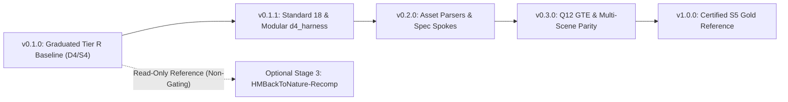

# Roadmap — HarvestMoonBackToNature-PlayStation

> **Baseline:** `v0.1.0` (`D4 / S4 / R2`) · **Active Horizon:** `v0.1.1` -> `v1.0.0` (`S5` Gold Research Container)
> **State & Links:** [`active.state`](active.state) · [`FEATURES.md`](FEATURES.md) · [`Dev/docs/plans/tasklist.md`](Dev/docs/plans/tasklist.md) · [`SPECIFICATIONS.md`](Dev/docs/SPECIFICATIONS.md)

---

## 1. North Star Goal (`v1.0.0` Summit)

Certify **`HarvestMoonBackToNature-PlayStation` (`SLUS-01115`)** as a self-contained **`S5` Gold Reference Research Container** (`s5_gold_report.json` `isPassed: true`, `unresolvedFieldCount == 0` in `spec_coverage.json`) featuring complete clean-room binary/asset/audio parsers, `150–380`-line `Dev\docs\specifications\*.md` format spokes, deterministic Q12 host GTE + multi-scene farm/festival trace parity in `Sandbox\`, and a zero-gap 4-Doc Research Manual Shelf.

> **Pure Research Container Rule:** This repository is a strictly self-contained `Tier R` research container. Downstream [`HMBackToNature-Recomp`](../HMBackToNature-Recomp/README.md) (`reStation`) consumes published `Dev\schemas\` and `Dev\docs\` strictly **read-only**—nothing in this roadmap gates or blocks Stage-3 recompilation tracks.

---

## 2. Active In-Dev Milestone (`v0.1.1` — Standard 18 & Modular `d4_harness`)

Focus: Fix schema drift, path bugs, and monolithic test caps so `D4`/`S4` verification runs cleanly, additively, and deterministically in `Sandbox\`.

- [ ] **`T1` — Standard 18 Reports & Fail-Closed Corpus Paths (`🗄️ Data & Schema`, Unlocked):**
  - Normalize `Dev/schemas/*.json` to Standard 18 keys (`generatedAtUtc`, `isPassed`, `unresolvedFieldCount`, `assertionsPassedCount`, `assertionsTotalCount`).
  - Ensure `hmbtn_unpack.py` / `hmbtn_assets.py` write strictly under `Sandbox\{data,logs,extracts}\`, emit structured `"status": "MISSING_CORPUS_MEDIA"` JSON on empty BYO-disc runs, and support `--offline-synthetic`.
- [ ] **`T2` — Multi-TU `d4_harness\` Split (`<= 250` LOC) & `verify_track_d4.py` Fixes (`🛠️ Build & Infra`, Unlocked):**
  - Refactor `Dev/scripts/d4_harness/` into `<= 250` LOC/file C translation units discovered via Pass-2 globbing inside `build_d4_*.py`.
  - Fix [`verify_track_d4.py`](Dev/scripts/verify_track_d4.py) hardcoded `== 8` test count cap and missing `Dev\docs\05-...` check (pointing cleanly to `Dev\docs\stages\05-...`).
- [ ] **`T3` — Hardened `D4` / `S4` & `> 64 MiB` SHA-256 Gate (`🧪 QA & Testing`, Blocked on `RND-T0`, `T1`, `T2`):**
  - Validate hardened `study_verifier.py` (`RND-T0`) hashes full `133,935,104`-byte `A_FILE.BIN` (`> 64 MiB`) alongside `verify_track_d4.py` and `Sandbox\` smoke runs (`0` warnings/errors).

---

## 3. Upcoming Stepping Stones (`v0.2.0` -> `v0.3.0` -> `v1.0.0`)

### `v0.2.0` — Clean-Room Container Parsers & `S5` Specification Spokes
- **`T4` — Flat `Dev/scripts/*.py` (`<= 250` LOC) Parsers (`⚙️ Core & Code`, Locked -> `[T3]`):** Author clean-room decoders/validators outputting strictly to `Sandbox\{data,logs,extracts}\` for Slot A (`0x800B7E20`) / Slot B (`0x8012DDE8`) overlays, `Part 9` `pBAV`/`pQES` audio banks, `0x0E` VRAM sprite frame tables, and calendar/affection/diary checksum layouts.
- **`T5` — Zero-Gap `Dev/docs/specifications/*.md` Spokes (`📘 Docs & DevLog`, Locked -> `[T3, T4]`):** Author `150–380`-line spec spokes linked from [`SPECIFICATIONS.md`](Dev/docs/SPECIFICATIONS.md) until `spec_coverage.json` hits `unresolvedFieldCount == 0`.

### `v0.3.0` — Q12 Host GTE & Multi-Scene Behavioral Trace Parity
- **`T6` — Host GTE Model & Multi-Scene Parity (`🧪 QA & Testing`, Locked -> `[T4, T5]`):** Replace `((void)0)` GTE (`COP2`) stubs in `ghidra_compat.h` with deterministic Q12 host GTE arithmetic and capture multi-scene farm/festival/save-load trace parity in `Sandbox\`.

### `v1.0.0` — Certified `S5` Gold Reference Research Container
- **`T7` — `S5` Gold Certification Gate (`🧪 QA & Testing`, Locked -> `[T5, T6]`):** Generate `Dev/schemas/s5_gold_report.json` (`isPassed: true`, `unresolvedFieldCount == 0`) and pass `decomp_cli.py verify --tier S5` (`0` err / `0` warn).
- **`T8` — Summit Manual Shelf & Notion Sync (`📘 Docs & DevLog`, Locked -> `[T7]`):** Finalize the `S5` Gold 4-Doc Manual Shelf, Root Quartet, `active.state` (`version: "1.0.0"`), and Notion summit parity.

---

## 4. Completed Milestones

- [x] **`v0.1.0` (`2026-11-14`) — Graduated `Tier R` Repository (`D4 / S4 / R1`):** Promoted `harvest-moon-btn` (`SLUS-01115`) out of `<PROJECTS_PERSONAL>/R&D` into 4-folder `Tier R` storage with `19` SHA-256 corpus artifacts, `3,828` indexed functions (`2,575` game + `1,253` PS1 SDK), `3,497` globals, `513/513` C TUs -> `libharvest_moon_btn_d4.a` (`3,463,828` B, `0` err/warn), `8/8` LP32 host parity tests, standalone `hmbtn_unpack.py` / `hmbtn_assets.py`, and read-only link to [`HMBackToNature-Recomp`](../HMBackToNature-Recomp/README.md).

---

## 5. Icebox & Cutting-Room Floor

- **`D5` (`1:1` Retail Byte-Matching Assembly / Codegen):** Optional per-TU PS1 SDK `4.70` instruction-exact matching of `SLUS_011.15` (`323,584` B) and `A_FILE` `Part 11` into `Dev/schemas/d5_byte_match.json`. Explicitly non-blocking for `v1.0.0` `S5` Gold and downstream [`HMBackToNature-Recomp`](../HMBackToNature-Recomp/README.md).
- **Regional Revision Differentials (`SLPS-02376` / `SLES-02689`):** Comparative offset/dialogue notes for JP (`Harvest Moon for Girls` / `Bokujou Monogatari`) and PAL (`50 Hz`) releases if compatible discs are later cataloged locally.
