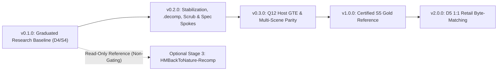

# Roadmap — HarvestMoonBackToNature-PlayStation

> **Baseline:** `v0.1.0-hf.1` (`D4 / S4 / R2`) · **Active Horizon:** `v0.2.0` -> `v0.3.0` -> `v1.0.0` (`S5` Gold) -> `v2.0.0` (`D5` Byte-Match)
> **State & Links:** [active.state](active.state) · [FEATURES.md](FEATURES.md) · [SECURITY.md](SECURITY.md) · [Dev/docs/plans/tasklist.md](Dev/docs/plans/tasklist.md) · [SPECIFICATIONS.md](Dev/docs/SPECIFICATIONS.md)

---

## 1. North Star Goals (`v1.0.0` Summit -> `v2.0.0` Horizon)

- **`v1.0.0` Summit (`S5` Gold Reference Research Container):** Certify **`HarvestMoonBackToNature-PlayStation` (`SLUS-01115`)** as a self-contained **`S5` Gold Reference** (`s5_gold_report.json` `isPassed: true`, `unresolvedFieldCount == 0` in `spec_coverage.json`) featuring clean-room `.decomp` bundle export, complete binary/asset/audio parsers, `150–380`-line `Dev/docs/specifications/*.md` format spokes, deterministic Q12 host GTE + multi-scene farm/festival trace parity in `--data-dir` / `Corpus/work/`, and a zero-gap 4-Doc Research Manual Shelf.
- **`v2.0.0` Horizon (`D5` 1:1 Retail Byte-Matching):** Optional per-TU PS1 MIPS C toolchain (`maspsx`) instruction-exact matching of `SLUS_011.15` (`323,584` B) and the `13` overlays into `Dev/schemas/d5_byte_match.json` (`matchedBinaryCount`, `mismatchedBytes`, `isPassed`) with fail-closed `"status": "MISSING_TOOLCHAIN"` handling when optional matching compilers are absent.

> **Pure Research Container Rule:** This repository is a strictly self-contained 3-folder research container. Downstream `HMBackToNature-Recomp` (`reStation`) consumes published `Dev/schemas/` and `Dev/docs/` strictly **read-only**—nothing in `v0.2.0`–`v2.0.0` gates or blocks Stage-3 recompilation tracks.

---

## 2. Active In-Dev Milestone (`v0.2.0` — Stabilization, `.decomp` Exporter, Public Scrub & Spec Spokes)

Focus: Fold `v0.1.1` stabilization into `v0.2.0` so schema verification, modular `d4_harness/` tests, clean-room `.decomp` bundling, public-repo PII/clean-room scrubbing, and container parsers/spec spokes run deterministically in isolated `--data-dir` / `Corpus/work/` runs.

- [ ] **`T0` — Integrity Gate, Canonical Reports & Clean-Room Paths:**
  - Index retail `SLUS-01115` media (`requiredDiscChecksums`), `SLUS_011.15`, `13` overlays, and `133,935,104`-byte `A_FILE.BIN` in [standalone_integrity.json](Dev/schemas/standalone_integrity.json) (removing `.gpr`), and enforce pre-unpack SHA-256 gating inside [hmbtn_unpack.py](Dev/scripts/hmbtn_unpack.py).
  - Normalize `Dev/schemas/*.json` to canonical report keys (`generatedAtUtc`, `isPassed`, `unresolvedFieldCount`, `assertionsPassedCount`, `assertionsTotalCount`), emit structured `"status": "MISSING_CORPUS_MEDIA"` JSON on empty BYO-disc runs, and support `--data-dir`, `--log-dir`, and `--offline-synthetic`.
- [ ] **`T1` — Multi-TU `d4_harness/` Split (`<= 250` SLOC) & Verifier Alignment:**
  - Split `Dev/scripts/d4_harness/` into domain C translation units (`<= 250` SLOC/TU) discovered via Pass-2 globbing inside [build_and_verify_d4.py](Dev/scripts/build_and_verify_d4.py).
  - Fix [verify_track_d4.py](Dev/scripts/verify_track_d4.py) (remove hardcoded `== 8` test count cap, check all object files, point to `Dev/docs/stages/05-...`) and decouple [verify_stage0_stage1.py](Dev/scripts/verify_stage0_stage1.py) and [verify_stage2_stage3.py](Dev/scripts/verify_stage2_stage3.py) with `--data-dir`, `--tools-dir`, and `--offline-synthetic`.
- [ ] **`T2` — Clean-Room `.decomp` Exporter (`reStation`) & Local Config:**
  - Author `Dev/scripts/export_decomp_bundle.py` (`<= 250` SLOC) + `Dev/schemas/decomp_recipe.json` targeting `reStation` (`0.2.x`), provide `Dev/schemas/decomp_local.example.json`, and ignore `*.decomp` and `/Dev/data/` in [.gitignore](.gitignore).
- [ ] **`T3`–`T4` — Clean-Room Schema Scrub, Public Hygiene, `> 64 MiB` Verification & Pre-Rewrite Backup:**
  - Clear all `106` non-empty retail `strings` arrays from [call_graph.json](Dev/schemas/call_graph.json) (`stage1_indexer.py` reads strings strictly in memory), replace vendor SDK comments in `Dev/schemas/types/*.h` with neutral PS1 hardware/ABI notes, parameterize `zig` (`ZIG_EXE` / `shutil.which("zig")`) and `RD_DECOMP_TOOLS` / `--tools-dir`, scrub workstation paths/PII/UUIDs, and add [SECURITY.md](SECURITY.md) + `## License & Legal` to [README.md](README.md).
  - Verify full `133,935,104`-byte `A_FILE.BIN` SHA-256 (`> 64 MiB`), cut pre-rewrite `Archive/*.7z` + isolated `git bundle` backups before human-gated full-history `git-filter-repo` scrub (`7a688b3` through `HEAD`).
- [ ] **`T5` — Modular Container Parsers (`<= 250` SLOC) & `Dev/docs/specifications/*.md` Spokes:**
  - Author dedicated `<= 250`-SLOC decoders (`hmbtn_overlays.py`, `hmbtn_sound.py`, `hmbtn_sprites.py`, `hmbtn_save_diary.py`) writing strictly to `--data-dir` / `Corpus/work/`, plus isolated unit tests (`<= 250` SLOC, `<= 400` raw lines) and `150–380`-line `Dev/docs/specifications/*.md` spokes until `spec_coverage.json` hits `unresolvedFieldCount == 0`.

### Empirical Verification Gates (Required Across Every Milestone)

1. **Isolated `--data-dir` + `--log-dir`:** Unpackers, builders, and verifiers run against `--data-dir <temp>` and `--log-dir Dev/logs`, writing zero files outside those directories and leaving `Corpus/standalone/` strictly read-only.
2. **`--offline-synthetic` Mode:** Host parity and Q12 GTE tests pass `100%` against synthetic fixtures when retail disc media is absent.
3. **Fail-Closed `MISSING_CORPUS_MEDIA`:** Running unpackers or `.decomp` exporters against an empty `--data-dir` exits non-zero cleanly with structured `"status": "MISSING_CORPUS_MEDIA"` JSON.
4. **Full `> 64 MiB` SHA-256 Gate:** `standalone_integrity.json` and the study verifier hash the full `133,935,104`-byte `A_FILE.BIN` and retail `SLUS-01115` disc with `0` skipped files.

---

## 3. Upcoming Stepping Stones (`v0.3.0` -> `v1.0.0` -> `v2.0.0`)

### `v0.3.0` — Q12 Host GTE & Multi-Scene Behavioral Trace Parity
- **`T6` — Host GTE (`COP2`) Model & Multi-Scene Parity:** Replace `((void)0)` GTE stubs in `ghidra_compat.h` with deterministic Q12 fixed-point host GTE arithmetic (`RTPS`/`RTPT`/`MVMVA`/`NCLIP`/`AVSZ3`/`FLAG` overflow bit `0x80000000`) runnable via `--offline-synthetic`, and capture fixed-seed multi-scene farm/festival/save-load traces in `--data-dir` / `Corpus/work/`.

### `v1.0.0` — Certified `S5` Gold Reference Research Container
- **`T7` — `S5` Gold Certification Gate:** Generate `Dev/schemas/s5_gold_report.json` (`isPassed: true`, `unresolvedFieldCount == 0`) and pass `decomp_cli.py verify --tier S5` (`0` err / `0` warn).
- **`T8` — Summit Manual Shelf & Sync:** Finalize the `S5` Gold 4-Doc Manual Shelf, Root Docs, and `active.state` (`version: "1.0.0"`).

### `v2.0.0` — `D5` 1:1 Retail Byte-Matching Horizon
- **`T9` — `D5` Byte-Exact Matching (`SLUS_011.15` + `13` Overlays):** Optional per-TU PS1 C toolchain (`maspsx`) instruction-exact matching outputting `Dev/schemas/d5_byte_match.json` (`matchedBinaryCount`, `mismatchedBytes`, `isPassed`), updating `verify_track_d4.py` to accept `D4`/`D5`, and failing closed with `"status": "MISSING_TOOLCHAIN"` if optional matching tools are absent.

---

## 4. Completed Milestones

- [x] **`v0.1.0` (`2026-11-14`) — Graduated Research Repository (`D4 / S4 / R1`):** Promoted `harvest-moon-btn` (`SLUS-01115`) into 3-folder research storage with SHA-256 corpus artifacts, `3,828` indexed functions (`2,575` game + `1,253` PS1 SDK), `3,497` globals, `513/513` C TUs -> `libharvest_moon_btn_d4.a` (`3,463,828` B, `0` err/warn), `8/8` LP32 host parity tests, standalone `hmbtn_unpack.py` / `hmbtn_assets.py`, and read-only downstream reference `HMBackToNature-Recomp`.

---

## 5. Icebox & Cutting-Room Floor

- **Regional Revision Differentials (`SLPS-02376` / `SLES-02689`):** Comparative offset/dialogue notes for JP (*Harvest Moon for Girls* / *Bokujou Monogatari*) and PAL (`50 Hz`) releases if compatible discs are later cataloged locally.
