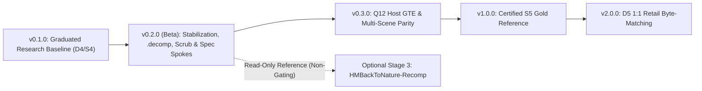

# Roadmap — HarvestMoonBackToNature-PlayStation

> **Current Baseline:** `v0.2.0` (`Beta` · `Pre-1.0` · `D4 / S4 / R2`) · **Active Horizon:** `v0.3.0` -> `v1.0.0` (`S5` Gold) -> `v2.0.0` (`D5` Byte-Match)
> **State & Links:** [active.state](active.state) · [FEATURES.md](FEATURES.md) · [SECURITY.md](SECURITY.md) · `Dev/docs/plans/tasklist.md` · [SPECIFICATIONS.md](Dev/docs/SPECIFICATIONS.md)

---

## 1. North Star Goals (`v1.0.0` Summit -> `v2.0.0` Horizon)

- **`v1.0.0` Summit (`S5` Gold Reference Research Container):** Certify **`HarvestMoonBackToNature-PlayStation` (`SLUS-01115`)** as a self-contained **`S5` Gold Reference** (`s5_gold_report.json` `isPassed: true`, `unresolvedFieldCount == 0` in [spec_coverage.json](Dev/schemas/spec_coverage.json)) featuring clean-room `.decomp` bundle export, complete binary/asset/audio parsers, `Dev/docs/specifications/*.md` format spokes, deterministic Q12 host GTE + multi-scene farm/festival trace parity in `--data-dir` / `Corpus/work/`, and a zero-gap 4-Doc Research Manual Shelf.
- **`v2.0.0` Horizon (`D5` 1:1 Retail Byte-Matching):** Optional per-TU PS1 MIPS C toolchain (`maspsx`) instruction-exact matching of `SLUS_011.15` (`323,584` B) and the `13` overlays into `Dev/schemas/d5_byte_match.json` (`matchedBinaryCount`, `mismatchedBytes`, `isPassed`) with fail-closed `"status": "MISSING_TOOLCHAIN"` handling when optional matching compilers are absent.

> **Pure Research Container Rule:** This repository is a strictly self-contained 3-folder research container. Downstream `HMBackToNature-Recomp` (`reStation`) consumes published `Dev/schemas/` and `Dev/docs/` strictly **read-only**—nothing in `v0.2.0`–`v2.0.0` gates or blocks Stage-3 recompilation tracks.

---

## 2. Active In-Dev Milestone (`v0.3.0` — Q12 Host GTE & Multi-Scene Behavioral Trace Parity)

Focus: Replace placeholder host GTE stubs with deterministic Q12 fixed-point `COP2` math runnable under `--offline-synthetic`, and capture fixed-seed multi-scene behavioral traces inside `--data-dir` / `Corpus/work/`.

- [ ] **`T8` — Host GTE (`COP2`) Model & Multi-Scene Behavioral Trace Parity:**
  - Replace `((void)0)` GTE stubs in `ghidra_compat.h` with deterministic Q12 fixed-point host GTE arithmetic (`RTPS` / `RTPT` / `MVMVA` / `NCLIP` / `AVSZ3` / `FLAG` overflow bit `0x80000000`) runnable via `--offline-synthetic`.
  - Capture fixed-seed multi-scene farm, festival, crop watering/growth, and diary save/load traces in `--data-dir` / `Corpus/work/` with zero retail-media leakage.

### Empirical Verification Gates (Required Across Every Milestone)

1. **Isolated `--data-dir` + `--log-dir`:** Unpackers, builders, and verifiers run against `--data-dir <temp>` and `--log-dir Dev/logs`, writing zero files outside those directories and leaving `Corpus/standalone/` strictly read-only.
2. **`--offline-synthetic` Mode:** Host parity and Q12 GTE tests pass `100%` against synthetic fixtures when retail disc media is absent.
3. **Fail-Closed `MISSING_CORPUS_MEDIA`:** Running unpackers or `.decomp` exporters against an empty `--data-dir` exits non-zero cleanly with structured `"status": "MISSING_CORPUS_MEDIA"` JSON.
4. **Full `> 64 MiB` SHA-256 Gate:** [standalone_integrity.json](Dev/schemas/standalone_integrity.json) and the study verifier hash the full `133,935,104`-byte `A_FILE.BIN` and retail `SLUS-01115` disc with `0` skipped files.

---

## 3. Upcoming Stepping Stones (`v1.0.0` -> `v2.0.0`)

### `v1.0.0` — Certified `S5` Gold Reference Research Container
- **`T9` — `S5` Gold Certification Gate:** Generate `Dev/schemas/s5_gold_report.json` (`isPassed: true`, `unresolvedFieldCount == 0`) and pass `decomp_cli.py verify --tier S5` (`0` err / `0` warn).
- **`T10` — Summit Manual Shelf & Sync:** Finalize the `S5` Gold 4-Doc Manual Shelf, Root Docs, and `active.state` (`version: "1.0.0"`).

### `v2.0.0` — `D5` 1:1 Retail Byte-Matching Horizon
- **`T11` — `D5` Byte-Exact Matching (`SLUS_011.15` + `13` Overlays):** Optional per-TU PS1 C toolchain (`maspsx`) instruction-exact matching outputting `Dev/schemas/d5_byte_match.json` (`matchedBinaryCount`, `mismatchedBytes`, `isPassed`), updating [verify_track_d4.py](Dev/scripts/verify_track_d4.py) to accept `D4`/`D5`, and failing closed with `"status": "MISSING_TOOLCHAIN"` if optional matching tools are absent.

---

## 4. Completed Milestones

- [x] **`v0.2.0` (`2026-11-17` — `Beta` / Pre-1.0 Public Release) — Stabilization, `.decomp` Exporter, Public Scrub & Spec Spokes (`D4 / S4 / R2`):**
  - **Integrity Gate & Canonical Reports (`T0`):** Normalized `Dev/schemas/*.json` to Standard 18 keys (`generatedAtUtc`, `isPassed`, `unresolvedFieldCount`, `assertionsPassedCount`, `assertionsTotalCount`), added `requiredDiscChecksums` + `133,935,104`-byte `A_FILE.BIN` SHA-256 gating and `"status": "MISSING_CORPUS_MEDIA"` exit to [hmbtn_unpack.py](Dev/scripts/hmbtn_unpack.py), dropped `.gpr` entries from [standalone_integrity.json](Dev/schemas/standalone_integrity.json), and shipped [s4_verify_report.json](Dev/schemas/s4_verify_report.json) + [spec_coverage.json](Dev/schemas/spec_coverage.json) (`68/68` fields mapped, `0` unresolved).
  - **Modular `d4_harness/` & Portable Verifiers (`T1`):** Split parity C runners into `<= 250`-SLOC translation units under `Dev/scripts/d4_harness/` discovered via Pass-2 globbing in [build_and_verify_d4.py](Dev/scripts/build_and_verify_d4.py), fixed [verify_track_d4.py](Dev/scripts/verify_track_d4.py) (all `514` `.o` ELF32 MIPS checks, uncapped assertion count, `Dev/docs/stages/05-...` path), and wired `--data-dir`, `--log-dir`, `--tools-dir` / `RD_DECOMP_TOOLS`, and `--offline-synthetic`.
  - **Clean-Room `.decomp` Exporter & Schema/Hygiene Scrub (`T2`–`T4`):** Added [export_decomp_bundle.py](Dev/scripts/export_decomp_bundle.py) + [decomp_recipe.json](Dev/schemas/decomp_recipe.json) targeting `reStation` (`0.2.x`), cleared all `106` non-empty retail `strings` arrays from [call_graph.json](Dev/schemas/call_graph.json), replaced vendor SDK comments in `Dev/schemas/types/*.h` with neutral PS1 ABI notes, scrubbed PII/workstation paths/UUIDs across tracked files, and added [SECURITY.md](SECURITY.md) + `## License & Legal` in [README.md](README.md) with `"requireHumanReviewBeforePush": true`.
  - **Modular Container Decoders, Spec Spokes & Public Release Closeout (`T5`–`T7`):** Shipped four `<= 250`-SLOC decoders ([hmbtn_overlays.py](Dev/scripts/hmbtn_overlays.py), [hmbtn_sound.py](Dev/scripts/hmbtn_sound.py), [hmbtn_sprites.py](Dev/scripts/hmbtn_sprites.py), [hmbtn_save_diary.py](Dev/scripts/hmbtn_save_diary.py)), `11/11` isolated `unittest` checks, and four specification spokes under `Dev/docs/specifications/`, verified across `verify_stage0_stage1` (`7/7`), `verify_stage2_stage3` (`8/8`), `build_and_verify_d4 --offline-synthetic` (`8/8`), `verify_track_d4` (`513` compiled, `8/8`), and `.decomp` clean-room packaging (`46` entries, `886,470` B, `0` violations), and closed `T7` with pre-rewrite backups, full-history `git-filter-repo` scrub (`0` leaks across all reachable blobs), and Stream-approved public release (`0.2.0.2026-11-17_0440.-.pre-public-human-review-gate.md`, `"isPublicRepo": true`).
- [x] **`v0.1.0-hf.1` (`2026-11-15`) — 3-Folder Tier R Normalization & Downstream `R2` Sync:** Standardized `.gitignore`, [active.state](active.state), [AGENTS.md](AGENTS.md), Root Docs, and verifiers on the 3-folder research layout and recorded downstream `HMBackToNature-Recomp v0.1.1` (`R2` Title Boot).
- [x] **`v0.1.0` (`2026-11-14`) — Graduated Research Repository (`D4 / S4 / R1`):** Promoted `harvest-moon-btn` (`SLUS-01115`) into 3-folder research storage with SHA-256 corpus artifacts, `3,828` indexed functions (`2,575` game + `1,253` PS1 SDK), `3,497` globals, `513/513` C TUs -> `libharvest_moon_btn_d4.a` (`3,463,828` B, `0` err/warn), `8/8` LP32 host parity tests, standalone `hmbtn_unpack.py` / `hmbtn_assets.py`, and read-only downstream reference `HMBackToNature-Recomp`.

---

## 5. Icebox & Cutting-Room Floor

- **Regional Revision Differentials (`SLPS-02376` / `SLES-02689`):** Comparative offset/dialogue notes for JP (*Harvest Moon for Girls* / *Bokujou Monogatari*) and PAL (`50 Hz`) releases if compatible discs are later cataloged locally.
