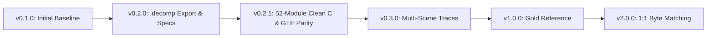

# Roadmap

Current baseline: **v0.2.1 (Beta)** | Active target: **v0.3.0** | See [CHANGELOG.md](CHANGELOG.md) for detailed release notes.

## Vision

- **v1.0.0 (Gold Reference):** Complete, self-contained format specifications (`0` unresolved fields) and deterministic multi-scene simulation parity for `SLUS-01115`.
- **v2.0.0 (Byte-Exact Matching):** Optional 1:1 instruction-exact matching against the original PS1 executable and 13 overlays using a matching MIPS C compiler.

## Active Milestone: v0.3.0 — Multi-Scene Behavioral Traces

- [ ] Expand the fixed-point GTE and simulation harness (`hm_gte_cop2.h`) to record deterministic multi-frame traces across Day-1 ranch intro, town festival, crop growth, and diary save/load scenes.
- [ ] Run all trace comparisons offline using synthetic fixtures without requiring retail disc media.

## Upcoming Milestones

- **v1.0.0 — Gold Reference:** Finalize all binary format specifications (`0` unresolved fields), multi-scene parity checks, and complete technical manuals.
- **v2.0.0 — 1:1 Byte Matching:** Add optional per-module MIPS C compiler verification (`maspsx`) with a clean fallback when the matching toolchain is not installed.

## Completed Milestones

- [x] **v0.2.1 (2026-11-18):** Consolidated the C corpus into 52 warning-free modules, preserved all decompilation tiers, and added 12 fixed-point GTE and simulation parity tests. ([Notes](CHANGELOG.md#021---2026-11-18-beta))
- [x] **v0.2.0 (2026-11-17):** Added clean-room `.decomp` bundle export, modular container decoders, format spec docs, and full public-repo scrubbing. ([Notes](CHANGELOG.md#020---2026-11-17-beta))
- [x] **v0.1.0-hf.1 (2026-11-15):** Standardized the 3-folder research layout and decoupled verification scripts from legacy workspace paths. ([Notes](CHANGELOG.md#010-hf1---2026-11-15))
- [x] **v0.1.0 (2026-11-14):** Established the standalone clean-room repository, disc unpacker, and initial C corpus. ([Notes](CHANGELOG.md#010---2026-11-14))

## Icebox

- **Regional Revisions (`SLPS-02376` / `SLES-02689`):** Comparative offset and dialogue notes for Japanese and European PAL releases.
